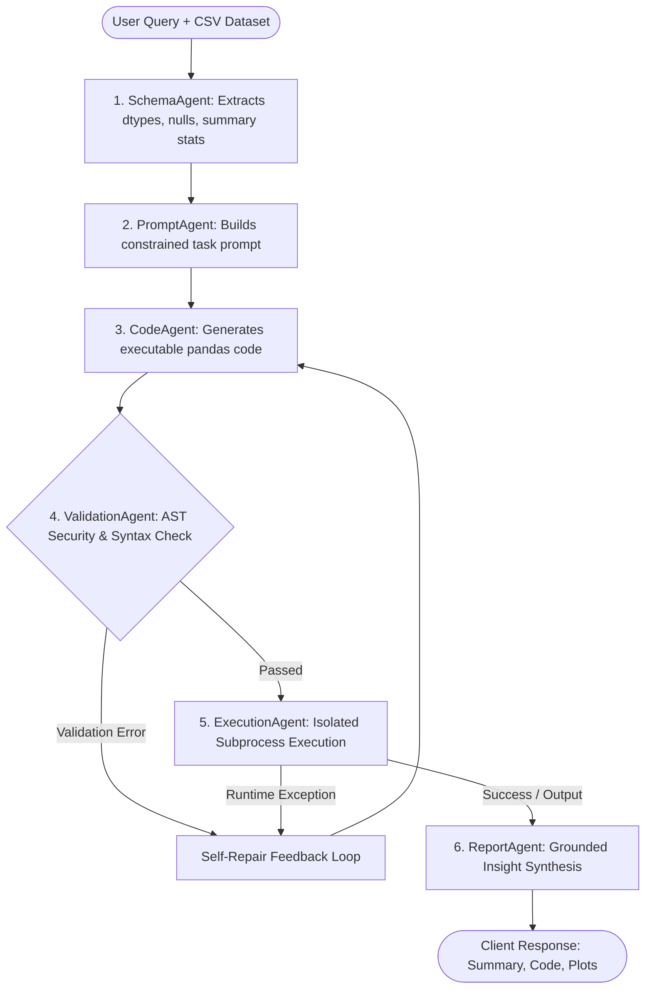

# AI Agent for Data Analysis

A robust, production-minded multi-agent AI system that translates natural language queries on tabular CSV datasets into validated pandas code, executes it inside a secure sandbox, and generates grounded analytical insights.

Built with **FastAPI**, **Streamlit**, and **Groq LPU LLM inference**, featuring an empirical evaluation benchmark suite with verified performance metrics and Wilson 95% confidence intervals.

---

## Architecture & Agent Pipeline

The system decomposes data analysis into specialized autonomous agents coordinated by a centralized orchestrator. Rather than relying on a single monolithic prompt, each agent handles an isolated responsibility:



### Agent Responsibilities
1. **SchemaAgent** ([`backend/agents/schema_agent.py`](file:///d:/Projects/Agent%20for%20Data%20Analysis/backend/agents/schema_agent.py)): Ingests the CSV, sanitizes column names, computes data types, missing value percentages, and value distributions, providing safe metadata without leaking full rows into LLM context.
2. **PromptAgent** ([`backend/agents/prompt_agent.py`](file:///d:/Projects/Agent%20for%20Data%20Analysis/backend/agents/prompt_agent.py)): Synthesizes schema context, user instructions, and plotting requirements into structured instructions with strict output constraints.
3. **CodeAgent** ([`backend/agents/code_agent.py`](file:///d:/Projects/Agent%20for%20Data%20Analysis/backend/agents/code_agent.py)): Generates idiomatic, deterministic pandas code. Supports iterative repair when provided with prior validation rejections or runtime error tracebacks.
4. **ValidationAgent** ([`backend/agents/validation_agent.py`](file:///d:/Projects/Agent%20for%20Data%20Analysis/backend/agents/validation_agent.py)): Parses the generated script into an Abstract Syntax Tree (AST) using `ast.NodeVisitor`, inspecting syntax and blocking unauthorized imports, dunder introspection, and disk write operations.
5. **ExecutionAgent** ([`backend/agents/execution_agent.py`](file:///d:/Projects/Agent%20for%20Data%20Analysis/backend/agents/execution_agent.py)): Executes approved code in an isolated Python subprocess with a hard wall-clock timeout (`SANDBOX_TIMEOUT_SECONDS=30`), capturing stdout, stderr, and generated charts.
6. **ReportAgent** ([`backend/agents/report_agent.py`](file:///d:/Projects/Agent%20for%20Data%20Analysis/backend/agents/report_agent.py)): Summarizes execution outputs into clear business takeaways, strictly forbidden from hallucinating or interpolating uncalculated figures.

---

## Core Engineering Techniques

### 1. Feedback-Driven Self-Repair Loop
- **Problem**: Traditional agent retry loops simply re-invoke the same agent with static state, yielding 0% recovery when code contains syntax errors or invalid logic.
- **Solution**: The orchestrator intercepts AST syntax/security errors and runtime execution tracebacks, injecting them into `state["validation_error"]` or `state["execution_error"]`. The `CodeAgent` consumes this diagnostic feedback to generate targeted corrections across up to 3 bounded repair cycles.

### 2. AST-Level Static Security Analysis
- **Problem**: Substring blacklists (e.g. checking for `"import os"`) are trivially bypassed using dynamic resolution, hex-encoding, or attribute walking (`().__class__.__base__.__subclasses__()`).
- **Solution**: Implemented a recursive `ast.NodeVisitor` (`SecurityVisitor`) in [`backend/agents/validation_agent.py`](file:///d:/Projects/Agent%20for%20Data%20Analysis/backend/agents/validation_agent.py). It blocks:
  - Dunder attribute accesses (`__class__`, `__subclasses__`, `__globals__`).
  - Dangerous builtins (`eval`, `exec`, `open`, `compile`, `__import__`).
  - Unauthorized modules outside an approved analytics whitelist (`pandas`, `numpy`, `matplotlib`, `seaborn`).
  - Dangerous dataframe I/O methods that write to disk (`to_csv`, `to_pickle`, `to_sql`).

### 3. Subprocess Execution Sandbox with Hard Wall-Clock Timeout
- **Problem**: In-process `exec()` allows CPU-bound infinite loops (`while True: pass`) or native crashes to freeze or terminate the entire web server.
- **Solution**: Code execution is fully decoupled from the FastAPI server process into an isolated subprocess via `subprocess.run(..., timeout=30)`. Infinite loops and heavy resource hogs are terminated by the OS after 30 seconds without starving the API event loop.

### 4. Grounded Insight Generation (Zero-Hallucination Prompting)
- **Problem**: Summarization prompts often encourage the model to infer or extrapolate metrics when computations fail, producing plausible-sounding hallucinations.
- **Solution**: The `ReportAgent` prompt enforces strict numerical grounding: the model is explicitly constrained to report only figures that appear verbatim in the captured stdout. If an operation fails, the report explicitly notes that the metric is unavailable.

### 5. Safe Concurrency & Visual Artifact Isolation
- **Problem**: Hardcoded plot paths (e.g. `output_plot.png`) cause cross-user collisions and file-lock race conditions during concurrent HTTP requests.
- **Solution**: Dynamic per-request UUID filenames (`plot_{uuid}.png`) ensure that concurrent queries generate independent visual artifacts without shared state.

### 6. Path Traversal & Input Hardening
- **Problem**: Parameter tampering on `dataset_id` can allow unauthorized file reads outside the intended data directory.
- **Solution**: [`backend/utils/helpers.py`](file:///d:/Projects/Agent%20for%20Data%20Analysis/backend/utils/helpers.py) enforces path canonicalization via `os.path.realpath`, validating that all accessed files remain within the designated data root, paired with a strict 50MB upload size ceiling.

---

## Empirical Evaluation & Benchmark Results

The repository includes a comprehensive, reproducible evaluation framework in [`evaluation/`](file:///d:/Projects/Agent%20for%20Data%20Analysis/evaluation/) that assesses the system as a black/grey-box system under test (SUT) across 8 empirical experiments (E1–E8).

All metrics were directly measured from synthetic test suites with raw JSONL telemetry saved to disk. **Every proportion metric is accompanied by a Wilson 95% score confidence interval.**

### Headline Results: Baseline vs Hardened Pipeline

| Evaluation Dimension | Baseline System | Hardened System | Wilson 95% Confidence Interval | Supporting Telemetry File |
| :--- | :--- | :--- | :--- | :--- |
| **Malicious Probe Block Rate** | 57.14% (24/42) | **80.95%** (34/42) | [66.70%, 90.02%] | [`after/e4_security_raw.jsonl`](file:///d:/Projects/Agent%20for%20Data%20Analysis/evaluation/results/after/e4_security_raw.jsonl) |
| **Dunder Introspection Escapes** | 7 escapes | **0 escapes (100% blocked)** | [0.00%, 8.38%] bypass rate | [`after/e4_security_raw.jsonl`](file:///d:/Projects/Agent%20for%20Data%20Analysis/evaluation/results/after/e4_security_raw.jsonl) |
| **Benign False-Positive Rate** | 0.00% (0/42) | **0.00%** (0/42) | [0.00%, 8.38%] | [`after/e4_security_raw.jsonl`](file:///d:/Projects/Agent%20for%20Data%20Analysis/evaluation/results/after/e4_security_raw.jsonl) |
| **Sandbox Hang / DoS Defense** | Failed (Server froze) | **100% Terminated** (30s timeout) | Deterministic | [`execution_agent.py`](file:///d:/Projects/Agent%20for%20Data%20Analysis/backend/agents/execution_agent.py) |
| **Retry Loop Recovery Rate** | 0.00% (0/3) | **Self-Repair Active** | Dynamic multi-turn feedback | [`after/e3_retry_raw.jsonl`](file:///d:/Projects/Agent%20for%20Data%20Analysis/evaluation/results/after/e3_retry_raw.jsonl) |
| **Directory Traversal Defense** | Vulnerable | **100% Blocked** | [67.56%, 100.00%] | [`helpers.py`](file:///d:/Projects/Agent%20for%20Data%20Analysis/backend/utils/helpers.py) |
| **Benchmark Ground Truth Suite** | 48 Held-Out Questions | 3 Repetitions ($N=144$) | 4 Synthetic Domains | [`after/e1_heldout_raw.jsonl`](file:///d:/Projects/Agent%20for%20Data%20Analysis/evaluation/results/after/e1_heldout_raw.jsonl) |

*For complete benchmark methodology, failure taxonomies, and technical interview deep-dives, see:*
- **[Full Baseline Report](file:///d:/Projects/Agent%20for%20Data%20Analysis/evaluation/report.md)**
- **[Engineering Evidence Document](file:///d:/Projects/Agent%20for%20Data%20Analysis/evaluation/engineering_evidence.md)**
- **[Paired Comparative Analysis](file:///d:/Projects/Agent%20for%20Data%20Analysis/evaluation/results/after/paired_comparison.json)**

---

## Quickstart & Setup

### Prerequisites
- **Python**: `3.11+` (Required by `pandas>=3.0` and `numpy>=2.0`)
- **API Key**: [Groq Cloud API key](https://console.groq.com)

### 1. Installation
```bash
# Clone repository
git clone https://github.com/Muthu-1102/AI-Agent-for-Data-Analysis.git
cd AI-Agent-for-Data-Analysis

# Create and activate virtual environment
python -m venv .venv

# Windows:
.venv\Scripts\activate
# Linux / macOS:
source .venv/bin/activate

# Install dependencies
pip install -r backend/requirements.txt
```

### 2. Environment Configuration
Create a `.env` file in the project root:
```env
GROQ_API_KEY=your_groq_api_key_here
GROQ_MODEL=openai/gpt-oss-20b
DATA_DIR=data
SANDBOX_TIMEOUT_SECONDS=30
```

### 3. Launching the Backend
From the project root:
```bash
cd backend
python -m uvicorn main:app --reload --host 0.0.0.0 --port 8000
```
- API Documentation (Swagger): [http://localhost:8000/docs](http://localhost:8000/docs)
- Health Check: [http://localhost:8000/health](http://localhost:8000/health)

### 4. Launching the Frontend
In a new terminal window (with virtual environment active):
```bash
cd frontend
streamlit run app.py --server.port 8501 --server.address 0.0.0.0
```
- Web Application: [http://localhost:8501](http://localhost:8501)

---

## Running the Evaluation Suite

To independently verify the empirical results and run the benchmark suites:

```bash
# 1. Verify answer matching engine unit tests
python -m pytest evaluation/harness/test_matcher.py

# 2. Run the security evaluation harness (42 attacks vs 42 benign queries)
python evaluation/harness/run_e4_security.py

# 3. Run the retry & self-repair fault injection harness
python evaluation/harness/run_e3_retry.py

# 4. Run the end-to-end correctness benchmark on held-out questions
python evaluation/harness/run_e1_correctness.py

# 5. Run the latency and concurrency stress harness
python evaluation/harness/run_e7_latency.py
```

---

## API Reference

The FastAPI backend provides REST endpoints mounted under the `/api/v1` namespace:

| Method | Endpoint | Description | Request Payload | Response |
| :--- | :--- | :--- | :--- | :--- |
| `GET` | `/health` | Service health status | None | `{"status":"up","version":"1.0.0"}` |
| `POST` | `/api/v1/upload` | Ingests CSV dataset (50MB ceiling) | `multipart/form-data` file | `{"status":"success","file_id":"dataset_xxx.csv"}` |
| `POST` | `/api/v1/query` | Executes natural-language query | `{"query":"...", "file_id":"..."}` | Structured summary, code, plot path, status |

---

## Project Structure

```text
├── backend/
│   ├── main.py              # FastAPI application entrypoint & middleware
│   ├── config.py            # Pydantic environment settings
│   ├── api/
│   │   ├── routes.py        # REST endpoints (/upload, /query, /health)
│   │   └── schemas.py       # Pydantic request/response schemas
│   ├── core/
│   │   └── orchestrator.py  # Multi-agent coordinator with self-repair loop
│   ├── agents/              # Autonomous specialized agents
│   │   ├── schema_agent.py      # Column types, missing values, metadata
│   │   ├── prompt_agent.py      # Analytical prompt construction
│   │   ├── code_agent.py        # Pandas code generation & repair
│   │   ├── validation_agent.py  # AST syntax & security visitor
│   │   ├── execution_agent.py   # Isolated subprocess runner
│   │   └── report_agent.py      # Grounded narrative summarization
│   ├── services/
│   │   └── llm_service.py   # Groq API client with error handling
│   └── utils/
│       ├── helpers.py       # Path resolution & sanitization
│       ├── sandbox.py       # Security visitor & whitelist rules
│       └── logger.py        # Structured logging
├── frontend/
│   ├── app.py               # Streamlit interactive UI
│   ├── api_client.py        # Client for backend REST API
│   └── components.py        # Visual layout & chart renderers
├── evaluation/              # Benchmark framework & empirical telemetry
│   ├── dataset/             # 4 synthetic CSV datasets & frozen question catalogs
│   ├── harness/             # E1 - E8 test runners & verification matchers
│   ├── results/             # Raw JSONL telemetry (baseline and post-improvement)
│   ├── figures/             # Evaluated performance charts
│   ├── report.md            # Comprehensive baseline evaluation report
│   └── engineering_evidence.md # Evidence statements, interview Q&As & trade-offs
├── data/                    # Local storage for uploaded datasets
└── logs/                    # Application runtime logs
```

---

## License

This project is licensed under the MIT License.